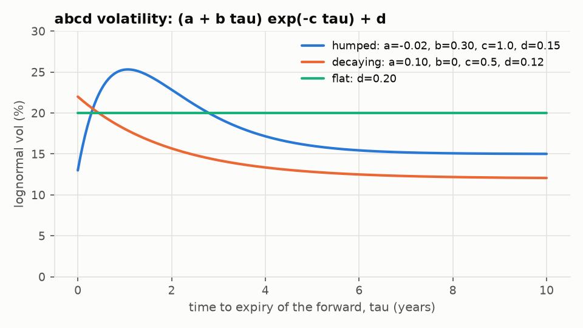
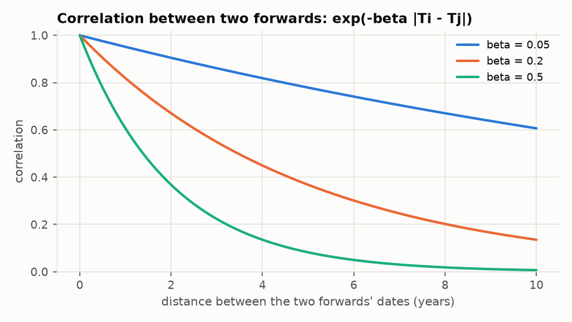
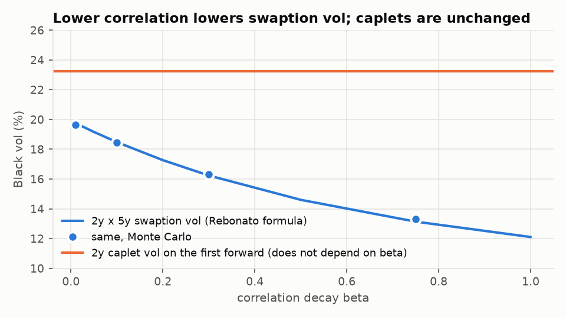

# LMM: the LIBOR (Forward) Market Model

A model of the whole curve of forward rates. It is used to price products whose value depends on
several rates and their path: Bermudan swaptions, callable range accruals, CMS spread options. This
page covers the set-up, every input and its impact, calibration, simulation, and interview questions.
It is part of the [interest rates](README.md) notes: formulas first, glossary at the end.

The name dates from LIBOR. Since LIBOR ended, the same model is applied to SOFR-based forward rates as
the **forward market model** (FMM) of Lyashenko and Mercurio. The mechanics are the same.

The figures come from [`img/make_figures.py`](img/make_figures.py), and the Monte Carlo simulation is
in [`img/lmm_lib.py`](img/lmm_lib.py). The code block runs on its own.

Contents:
1. [Why LMM](#1-why-lmm)
2. [Set-up and dynamics](#2-set-up-and-dynamics)
3. [Volatility: the abcd shape](#3-volatility-the-abcd-shape)
4. [Correlation](#4-correlation)
5. [Swaptions and the impact of correlation](#5-swaptions-and-the-impact-of-correlation)
6. [Adding a smile](#6-adding-a-smile)
7. [Simulation and Bermudans](#7-simulation-and-bermudans)
8. [Parameter impact summary](#8-parameter-impact-summary)
9. [LMM vs Hull-White](#9-lmm-vs-hull-white)
10. [Interview questions](#10-interview-questions)
11. [Glossary](#11-glossary)

---

## 1. Why LMM

- **Short-rate models** such as Hull-White model one unobservable instantaneous rate and derive
  everything else from it. LMM models the rates the market actually trades: the forward rate over
  each period.
- Under its own pricing measure each forward is lognormal, so **caplets price exactly by Black's
  formula**. The model agrees with how the market quotes, by construction.
- Many **factors** (independent random drivers) give realistic **decorrelation**: the 2-year and
  10-year rates do not move in lockstep. That matters for any product that depends on the shape of
  the curve or has several exercise dates.
- The cost: most products have no closed form, so pricing is by Monte Carlo.

---

## 2. Set-up and dynamics

**Tenor dates** `T_0 < T_1 < … < T_{N+1}`, with period length `τ_i = T_{i+1} - T_i`.
**Forward rate** `F_i(t)` for the period `[T_i, T_{i+1}]`:

`F_i(t) = (P(t, T_i) / P(t, T_{i+1}) - 1) / τ_i`

**Dynamics.** Each forward is a driftless lognormal process under the `T_{i+1}`-**forward measure**,
the pricing measure that uses the bond maturing at `T_{i+1}` as the unit of account:

`dF_i = σ_i(t) F_i dW_i`, with `corr(dW_i, dW_j) = ρ_ij`

To simulate all the forwards together you need **one** measure, and that adds drifts:

| Measure (numeraire) | Drift of `F_i` |
|---|---|
| **Terminal** (`P(t, T_{N+1})`) | `μ_i = -σ_i Σ_{j=i+1..N} τ_j ρ_ij σ_j F_j / (1 + τ_j F_j)` |
| **Spot** (rolling one-period bond) | `μ_i = +σ_i Σ_{j=q(t)..i} τ_j ρ_ij σ_j F_j / (1 + τ_j F_j)`, where `q(t)` is the first forward not yet fixed |

**What the drift means:** it is the correction that keeps prices free of arbitrage when every forward
is priced with the same numeraire. It depends on the other forwards, so the joint distribution is
not lognormal and most products have no closed form.

**Caplet price** (exact in the model):
`Caplet_i = P(0, T_{i+1}) τ_i × Black(F_i(0), K, v_i²)`, with `v_i² = ∫_0^{T_i} σ_i(t)² dt`.

---

## 3. Volatility: the abcd shape

A forward's vol is usually written as a function of its **time to expiry** `τ = T_i - t`. This is
called time-homogeneous, and it keeps future vol curves looking like today's:

`σ_i(t) = k_i × [(a + b τ) e^(-c τ) + d]`



| Parameter | Controls |
|---|---|
| `a + d` | vol of a forward about to fix (`τ = 0`) |
| `d` | long-dated vol: the level for forwards far from fixing |
| `b`, `c` | the **hump**, which peaks at `τ = 1/c - a/b` (about 1 year here) |
| `k_i` | per-forward scaling, set so each caplet matches exactly (close to 1 if the shape is good) |

**Why a hump:** rates one to two years ahead are the most sensitive to expectations about the central
bank, so their vol is highest. Very short forwards are anchored by the current policy rate, and long
ones average out.

**Impact:** the shape decides how vol is spread **through time**. Two shapes can match the same
caplet (the same total `∫σ²`) and still give different **forward volatility**, the vol of a caplet
that starts later. So they price forward-starting options and Bermudans differently.

---

## 4. Correlation

The simplest useful form:

`ρ_ij = exp(-β |T_i - T_j|)`



- A small `β` means the curve moves almost in parallel. A large `β` means distant forwards move
  independently.
- Richer forms (Rebonato, Schoenmakers-Coffey) let correlation decay more slowly between long-dated
  forwards, which matches history.
- **Factor reduction:** a full `N × N` correlation matrix needs `N` random drivers. Keep its top two
  or three eigenvectors, as in [PCA](README.md#6-curve-trades-and-pca), and rescale so each forward
  still has variance 1. Fewer factors run faster but make rates more correlated than intended.

---

## 5. Swaptions and the impact of correlation

A swap rate is a weighted average of forwards:
`S(t) = Σ w_i(t) F_i(t)`, with `w_i = τ_i P(t, T_{i+1}) / A(t)`, where `A` is the annuity.

**Rebonato's formula** freezes the weights at today's values and gives the swaption's Black vol:

`σ_S² × T_start ≈ Σ_i Σ_j w_i w_j F_i F_j ρ_ij ∫_0^{T_start} σ_i(t) σ_j(t) dt / S²`

**The key consequence:** caplets depend only on each `σ_i`, but swaptions depend on `σ_i` **and**
`ρ_ij`. Lower correlation means more diversification inside the swap rate, so a lower swaption vol.

```python
import numpy as np

tenor = np.arange(0, 12, dtype=float)          # T_0 .. T_11, annual
fwd = np.full(11, 0.035)                       # F_i covers [T_i, T_i+1]
disc = np.r_[1.0, np.cumprod(1 / (1 + fwd))]   # P(0, T_k)


def abcd(tau, a=-0.02, b=0.30, c=1.0, d=0.15):
    tau = np.maximum(tau, 0.0)
    return (a + b * tau) * np.exp(-c * tau) + d


def cov(i, j, t_end, beta, n=400):
    """rho_ij x integral of sigma_i sigma_j from 0 to t_end."""
    t = np.linspace(0, t_end, n)
    rho = np.exp(-beta * abs(tenor[i] - tenor[j]))
    return rho * np.trapezoid(abcd(tenor[i] - t) * abcd(tenor[j] - t), t)


def caplet_vol(i):
    return np.sqrt(cov(i, i, tenor[i], 0.0) / tenor[i])


def swaption_vol(start, end, beta):
    """Rebonato's formula: Black vol of the forward swap rate from LMM inputs."""
    idx = np.arange(start, end)
    w = disc[idx + 1] / disc[idx + 1].sum()                  # annuity weights
    S = w @ fwd[idx]
    var = sum(w[a] * w[b] * fwd[i] * fwd[j] * cov(i, j, tenor[start], beta)
              for a, i in enumerate(idx) for b, j in enumerate(idx))
    return np.sqrt(var / tenor[start]) / S


print(f"2y caplet vol {caplet_vol(2):.2%} (no correlation input at all)")   # 23.23%
for beta in (0.01, 0.1, 0.5, 1.0):
    print(f"beta {beta:4}: 2y x 5y swaption vol {swaption_vol(2, 7, beta):.2%}")
# beta 0.01: 19.75%   beta 0.1: 18.48%   beta 0.5: 14.60%   beta 1.0: 12.11%
```



The Monte Carlo dots come from simulating the full model under the terminal measure, and they agree
with the formula. In the same simulation, the 3-year caplet came out within 1% of its Black price,
and the gap shrinks as the time step shrinks.

**The calibration tension:** caplets fix the `σ_i`, and swaptions then pin down the correlation.
Market prices often imply correlations that conflict with history or with each other, so desks choose
which instruments to match exactly. Usually these are the **co-terminal swaptions** of the trade:
all the expiries into swaps that end on the same date, which are exactly a Bermudan's exercise
choices.

---

## 6. Adding a smile

Plain LMM gives each forward a flat Black smile. These extensions add one:

| Extension | Dynamics | Gives |
|---|---|---|
| **Displaced diffusion** (shifted LMM) | `dF_i = σ_i (F_i + s) dW_i` | skew, and works near zero or with negative rates |
| **CEV LMM** (constant elasticity of variance) | `dF_i = σ_i F_i^β dW_i` | skew, like SABR's `β` |
| **Stochastic vol LMM / SABR-LMM** | each `σ_i` is multiplied by a common or per-forward random vol, correlated with the rates | a full smile consistent with each expiry's [SABR](sabr.md) fit, plus dynamics across expiries |

**Impact:** a smile extension changes the price of anything not at the money. The correlation between
rates and vol also changes Bermudan exercise decisions.

---

## 7. Simulation and Bermudans

**Simulation.**
- Simulate `ln F_i`, which keeps rates positive in the lognormal model, with time steps that land on
  every tenor date.
- The drift depends on the forwards themselves. A **predictor-corrector** step removes most of the
  time-step bias: compute the drift at the start of the step and at a trial end, then average them.
- Use one measure for all forwards (terminal or spot), and value a payoff as
  `numeraire(0) × E[payoff / numeraire(T)]`.
- Variance reduction: antithetic paths, and control variates such as caplets, which have exact
  prices.

**Bermudan swaptions** can be exercised on several dates, so pricing needs the **exercise decision**:
- **Longstaff-Schwartz** (least-squares Monte Carlo) works backwards from the last exercise date. At
  each date it regresses the continuation value on functions of the current state (swap rate,
  annuity), and exercises when the immediate value is higher. This gives a **lower bound**: a valid
  exercise rule that may not be the best one.
- **Andersen-Broadie** duality gives an upper bound. The gap between the two shows how good the rule
  is.
- **Impact of parameters:** lower correlation between rates at different exercise dates (a higher
  `β` or a more humped vol) makes the right to choose between swaps more valuable. Bermudans then
  become more expensive relative to the most expensive European swaption.

---

## 8. Parameter impact summary

| Input | Calibrated to | Main impact |
|---|---|---|
| `k_i` (per-forward scale) | caplets or at-the-money swaptions | matches each instrument exactly |
| abcd shape | term structure of vol | forward vol, forward-starting options, Bermudans |
| Correlation `β` | swaptions vs caplets, or history | swaption vols, spread options, Bermudans |
| Number of factors | speed vs realism | too few makes rates too correlated |
| Shift or CEV `β` | skew | options away from the money |
| Vol of vol, rate-vol correlation | smile | wings, CMS, exercise decisions |

---

## 9. LMM vs Hull-White

| | Hull-White (one factor) | LMM |
|---|---|---|
| State | one short rate | N forward rates |
| Fits today's curve | yes, via `θ(t)` | yes, by construction |
| Caplets / swaptions | closed form; fits a few | caplets exact, swaptions by approximation; can fit many |
| Decorrelation | none: all rates perfectly correlated | yes, any correlation structure |
| Smile | none (normal model) | through extensions |
| Pricing method | trees and PDEs: fast and accurate for Bermudans | Monte Carlo: slower, flexible for path dependence |
| Typical use | Bermudans and callables at scale, xVA (valuation adjustments for credit, funding and capital) | exotic, multi-rate, path-dependent products |

---

## 10. Interview questions

**Q1. Why does Black's formula price a caplet exactly in LMM?**
- Formula: under the `T_{i+1}`-forward measure, `dF_i = σ_i F_i dW_i` with no drift, so `F_i(T_i)` is
  lognormal with variance `∫σ_i² dt`.
- Why: the caplet pays `τ max(F_i - K, 0)` at `T_{i+1}`. Dividing by the numeraire
  `P(T_{i+1}, T_{i+1}) = 1` leaves the payoff unchanged, so its value is Black's formula under the
  forward measure.

**Q2. Why do the forwards have drifts when you simulate them together?**
- Formula (terminal measure): `μ_i = -σ_i Σ_{j>i} τ_j ρ_ij σ_j F_j / (1 + τ_j F_j)`.
- Why: each forward is driftless only under its own measure. One simulation needs one numeraire,
  and changing to it adds this drift.

**Q3. How does correlation affect caplets and swaptions?**
- Formula: caplet variance is `∫σ_i²`; swaption variance is `≈ Σ w_i w_j F_i F_j ρ_ij ∫σ_iσ_j / S²`.
- Numbers: in the example, the 2y caplet vol stays at 23.2% while the 2y × 5y swaption vol falls
  from 19.8% to 12.1% as `β` rises from 0.01 to 1.
- Why: a swap rate is an average of forwards. The less correlated they are, the more their moves
  cancel.

**Q4. Where is the hump of `(a + bτ) e^(-cτ) + d`, with a = -0.02, b = 0.3, c = 1?**
- Formula: set the derivative to zero: `τ* = 1/c - a/b`.
- Numbers: `1 - (-0.02 / 0.3) = 1.07` years.

**Q5. What are co-terminal swaptions, and why calibrate to them for a Bermudan?**
- A 10-year Bermudan exercisable every year is a choice among the 1y × 9y, 2y × 8y, … 9y × 1y
  swaptions, which all end at year 10. Matching those exactly makes the model agree with the market
  on each exercise choice; the model only has to supply the correlation between them.

**Q6. Why does Longstaff-Schwartz give a lower bound?**
- Formula: price = `E[discounted payoff under the estimated exercise rule]`.
- Why: any exercise rule is one you could actually follow, and the optimal rule gives the highest
  value. An estimated rule can only match it or do worse.

**Q7. Hull-White or LMM for a book of plain Bermudan swaptions? Why?**
- Hull-White, or a two-factor version, on a PDE or tree: it is fast, has stable Greeks, and can be
  calibrated to the co-terminal swaptions. LMM is the choice when the product depends on several
  rates (spread options) or decorrelation matters a lot.

---

## 11. Glossary

| Term | Plain meaning |
|---|---|
| abcd | A four-parameter shape for a forward's vol by time to expiry |
| Bermudan swaption | Swaption exercisable on several dates |
| CEV | Constant elasticity of variance: vol proportional to a power of the rate |
| Co-terminal swaptions | Swaptions with different expiries whose swaps all end on the same date |
| Decorrelation | Different rates not moving in lockstep |
| Displaced diffusion | Model applied to `rate + shift`, giving skew and allowing negative rates |
| Factor | An independent random driver in the simulation |
| FMM | Forward market model: LMM for backward-looking rates such as compounded SOFR |
| Forward measure | Pricing measure that uses a zero-coupon bond as the unit of account |
| Longstaff-Schwartz | Monte Carlo method that estimates the exercise rule by regression |
| Numeraire | The asset used as the unit of account when pricing |
| Predictor-corrector | Time step that averages the drift at the start and at a trial end of the step |
| Rebonato's formula | Approximate swaption vol from LMM vols and correlations |
| Tenor dates | The schedule of period start and end dates |
| Time-homogeneous | Vol depends only on time to expiry, not on calendar time |
