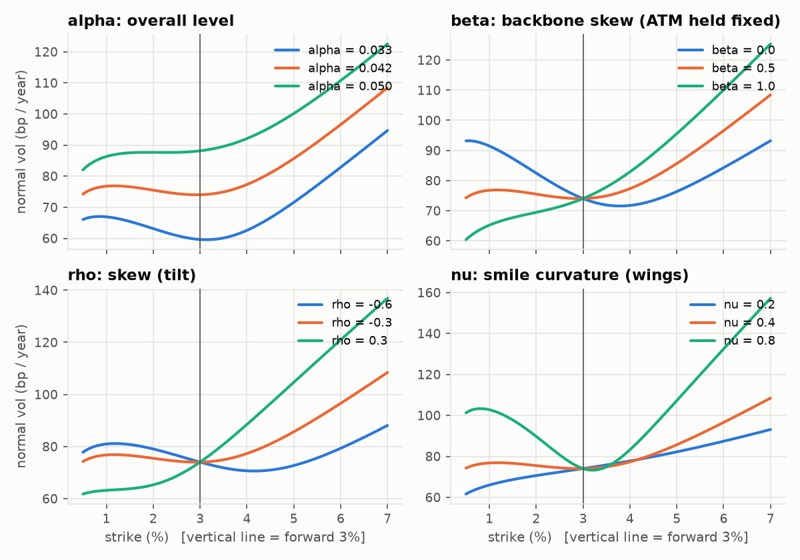
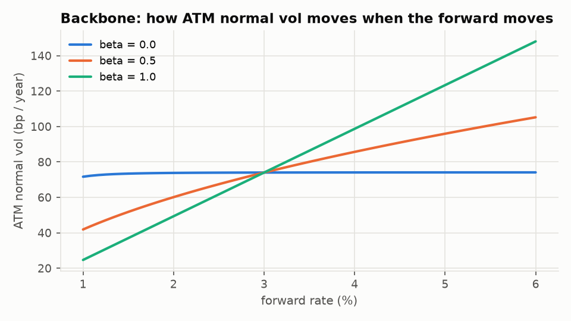
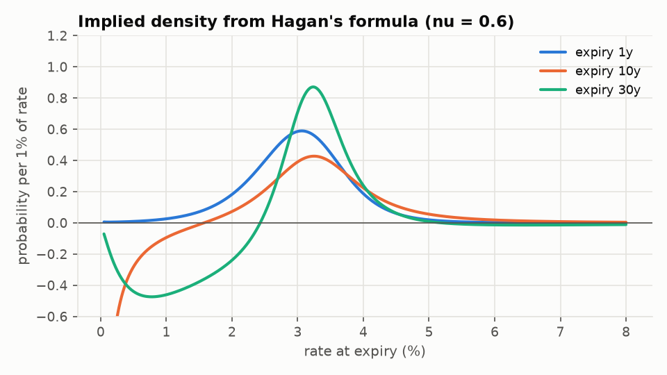

# SABR: the Volatility Smile Model

The standard model for the **volatility smile** of swaptions and caps, meaning implied volatility that
changes with strike. This page covers what each parameter does, how the model is calibrated, how it
changes your hedges, and where it breaks. It is part of the [interest rates](README.md) notes:
formulas first, then numbers, glossary at the end.

The figures are made by [`img/make_figures.py`](img/make_figures.py), with shared code in
[`img/sabr_lib.py`](img/sabr_lib.py). The code block runs on its own.

Contents:
1. [Why a smile model](#1-why-a-smile-model)
2. [The model](#2-the-model)
3. [Hagan's formula](#3-hagans-formula)
4. [What each parameter does](#4-what-each-parameter-does)
5. [Calibration](#5-calibration)
6. [Risk: how SABR changes your hedges](#6-risk-how-sabr-changes-your-hedges)
7. [Where SABR breaks and the fixes](#7-where-sabr-breaks-and-the-fixes)
8. [Interview questions](#8-interview-questions)
9. [Glossary](#9-glossary)

---

## 1. Why a smile model

- The market quotes a different implied volatility for each strike. Black's or Bachelier's model,
  with one volatility, cannot reproduce that.
- Interpolating the quotes directly gives prices but not **dynamics**: how the smile moves when the
  forward rate moves. The dynamics decide your delta hedge.
- **Local volatility** models (volatility as a function of rate and time) fit the smile exactly.
  But they predict the smile moves the *opposite* way to the market when the forward moves, so their
  hedges are worse than Black's. Hagan et al. (2002) introduced SABR to fix this.
- SABR fits each expiry's smile with a few meaningful parameters, and it predicts the right direction
  of smile movement.

---

## 2. The model

For one expiry, the forward rate `F` (the forward swap rate for swaptions, the forward rate for
caplets) and its volatility `α` follow:

```
dF = α F^β dW
dα = ν α dZ
corr(dW, dZ) = ρ
```

| Symbol | Name | Range | Meaning |
|---|---|---|---|
| `F` | forward | | the rate the option is written on; it has no drift under its own pricing measure |
| `α` | alpha | > 0 | current level of volatility (itself random) |
| `β` | beta, the **backbone** exponent | 0 to 1 | how volatility scales with the rate level: `β = 0` is normal, `β = 1` lognormal |
| `ρ` | rho | -1 to 1 | correlation between rate moves and volatility moves |
| `ν` | nu, **vol of vol** | ≥ 0 | how much the volatility itself moves |

Each expiry and swap length gets its own parameters. SABR models one smile, not the whole curve;
for the whole curve, see [LMM](lmm.md).

---

## 3. Hagan's formula

The model has no exact closed-form price. Hagan's expansion gives the implied Black volatility for
any strike directly:

```
σ_B(K) ≈ α / [(FK)^((1-β)/2) × (1 + (1-β)²/24 × ln²(F/K) + …)] × z / x(z) × [1 + (…) T]
z    = (ν/α) (FK)^((1-β)/2) ln(F/K)
x(z) = ln[(√(1 - 2ρz + z²) + z - ρ) / (1 - ρ)]
```

The full formula is in the code below. **At the money** (`K = F`) it is simple:

```
σ_ATM ≈ α / F^(1-β) × [1 + ((1-β)² α² / (24 F^(2-2β)) + ρβνα / (4 F^(1-β)) + (2 - 3ρ²) ν² / 24) T]
```

- The first factor `α / F^(1-β)` sets the level.
- The bracket is a small time correction. Note that `ν²` raises at-the-money vol a little.

**In rates**, desks usually quote **normal volatility** (basis points per year). There are two common
set-ups:
- **Normal SABR** (`β = 0`): rates can go negative. There is a matching normal-vol version of Hagan's
  formula.
- **Shifted SABR**: replace `F` and `K` with `F + s` and `K + s` for a fixed shift `s` (for example
  2%), so the model works when rates are near or below zero.

---

## 4. What each parameter does

Each panel changes one parameter and keeps the rest at `β = 0.5, ρ = -0.3, ν = 0.4`. The expiry is
5 years, the forward is 3%, and the smile is plotted in normal vol.



| Parameter | Effect on the smile | Effect on dynamics and risk |
|---|---|---|
| `α` | moves the whole smile up or down | main driver of vega (sensitivity to volatility) |
| `β` | tilts the smile; lower `β` gives higher normal vol at low strikes | sets the **backbone**, how at-the-money vol moves with `F`, so it changes delta |
| `ρ` | tilts the smile; negative `ρ` lifts low strikes, positive `ρ` lifts high strikes | the **vanna** exposure (vega that changes as rates move) |
| `ν` | bends both wings up: more curvature | the **volga** exposure (vega that changes as vol moves); prices of far strikes |

**The backbone.** Keep the parameters fixed and move the forward. The at-the-money vol traces a path
that depends only on `β`:



- `β = 0`: normal vol stays flat when rates move, so rates move the same number of basis points at
  any level.
- `β = 1`: normal vol is proportional to the rate, so moves are a fixed percentage.
- Pick `β` to match how the market's at-the-money vol actually moves with rates. Regress `ln σ_ATM` on
  `ln F` over history, using Black vols; the slope is `β - 1`.

**`β` and `ρ` overlap.** On a single day's smile, both create skew. A low `β` with some `ρ` can fit
the same smile as a high `β` with a more negative `ρ`. So desks **fix `β`** (by currency convention,
or from the backbone regression) and calibrate only `α`, `ρ` and `ν`.

---

## 5. Calibration

**Standard procedure** for each expiry and swap length in the swaption **volatility cube**:
1. Fix `β`, and the shift if using shifted SABR.
2. Solve for `α` from the at-the-money vol. One equation, one unknown, so it is matched exactly.
3. Fit `ρ` and `ν` to the other strikes by least squares, often weighted by vega or liquidity.
4. Smooth the parameters across expiries and swap lengths so the cube has no jumps.

The code fits the same "market" smile with three different values of `β`, then compares the hedges:

```python
import numpy as np
from scipy.optimize import least_squares
from scipy.stats import norm


def sabr_vol(F, K, T, alpha, beta, rho, nu):
    """Hagan (2002) Black implied vol."""
    fk, lfk, ob = F * K, np.log(F / K), 1 - beta
    z = nu / alpha * fk ** (ob / 2) * lfk
    x = np.log((np.sqrt(1 - 2 * rho * z + z**2) + z - rho) / (1 - rho))
    zx = np.where(np.abs(z) < 1e-8, 1.0, z / np.where(np.abs(x) < 1e-12, 1.0, x))
    denom = fk ** (ob / 2) * (1 + ob**2 / 24 * lfk**2 + ob**4 / 1920 * lfk**4)
    corr = 1 + (ob**2 / 24 * alpha**2 / fk**ob + rho * beta * nu * alpha / (4 * fk ** (ob / 2))
                + (2 - 3 * rho**2) / 24 * nu**2) * T
    return alpha / denom * zx * corr


def calibrate(F, strikes, T, market_vols, beta):
    """Fit alpha, rho, nu with beta fixed."""
    def errors(p):
        return sabr_vol(F, strikes, T, p[0], beta, p[1], p[2]) - market_vols
    fit = least_squares(errors, x0=[0.2 * F ** (1 - beta), 0.0, 0.3],
                        bounds=([1e-4, -0.999, 1e-4], [5.0, 0.999, 5.0]))
    return fit.x, np.abs(fit.fun).max()


def sabr_delta(F, K, T, params, beta, h=1e-5):
    """Black delta plus the vega effect of the smile moving with F (the backbone)."""
    a, r, n = params
    vol = sabr_vol(F, K, T, a, beta, r, n)
    d1 = (np.log(F / K) + 0.5 * vol**2 * T) / (vol * np.sqrt(T))
    dvol_dF = (sabr_vol(F + h, K, T, a, beta, r, n) - sabr_vol(F - h, K, T, a, beta, r, n)) / (2 * h)
    return norm.cdf(d1) + F * norm.pdf(d1) * np.sqrt(T) * dvol_dF


F, T = 0.03, 5.0
strikes = F + np.array([-0.015, -0.01, -0.005, 0, 0.005, 0.01, 0.02])
market = sabr_vol(F, strikes, T, 0.042, 0.5, -0.3, 0.4)        # pretend market quotes

for beta in (0.0, 0.5, 1.0):
    (a, r, n), worst = calibrate(F, strikes, T, market, beta)
    delta = sabr_delta(F, F, T, (a, r, n), beta)
    print(f"beta {beta}: alpha {a:.4f} rho {r:+.3f} nu {n:.3f} | worst fit error "
          f"{worst * 100:.2f} vol points | ATM delta {delta:.3f}")
# beta 0.0: alpha 0.0072 rho +0.095 nu 0.329 | worst fit error 0.21 vol points | ATM delta 0.486
# beta 0.5: alpha 0.0420 rho -0.300 nu 0.400 | worst fit error 0.00 vol points | ATM delta 0.611
# beta 1.0: alpha 0.2608 rho -0.543 nu 0.519 | worst fit error 0.21 vol points | ATM delta 0.729
```

**What this shows:**
- All three fits are within about 0.2 vol points, which is inside a typical bid-offer spread. The
  smile alone cannot tell you `β`.
- Yet the at-the-money delta ranges from 0.49 to 0.73. The choice of `β` changes how much you hedge.
- `ρ` compensates for `β`: lower `β` gives higher `ρ`, as described in section 4.

**Practical issues:**
- Parameters that jump from day to day create P&L noise. Penalise changes from yesterday's values.
- Short expiries have very steep smiles, which push `ν` high. For long expiries, the formula's errors
  grow with `ν² T` (section 7).
- Calibrate to liquid strikes only, and extrapolate the far wings separately.

---

## 6. Risk: how SABR changes your hedges

**Delta.** In Black's model, delta is `∂C/∂F` with volatility held fixed. In SABR the implied vol also
moves when `F` moves:

`Δ_SABR = Δ_Black + vega × ∂σ_B/∂F`

The second term comes from the backbone. With `β < 1` it is negative for at-the-money options,
because Black vol falls as the forward rises.

**Bartlett's delta** (2006) also accounts for `α` tending to move with `F` when `ρ ≠ 0`:

`Δ_Bartlett = Δ_Black + vega × (∂σ_B/∂F + ∂σ_B/∂α × ρν / F^β)`

It hedges better in practice because it uses the same correlation the model assumes.

**Vega and the smile risks:**

| Risk | Sensitivity to | Hedged with |
|---|---|---|
| Vega | `α` (level) | at-the-money swaptions |
| Vanna (rho risk) | `ρ` (skew) | risk reversals: buy one side, sell the other |
| Volga (nu risk) | `ν` (curvature) | strangles: buy or sell both wings |

**Products most affected by SABR choices:**
- Options away from the money, because of the skew and wings.
- **CMS** (constant maturity swap) products. Their price is an integral of the swaption smile over
  *all* strikes, so the far wings matter a lot.

---

## 7. Where SABR breaks and the fixes

**Negative probabilities.** The implied density of the rate at expiry is the second derivative of the
call price with respect to strike. Hagan's formula is an approximation. For long expiries or high vol
of vol, the density it implies turns negative at low strikes. That is an arbitrage: a butterfly
spread with a negative price.



The parameters are the same in all three (`β = 0.5, ρ = -0.3, ν = 0.6`, at-the-money Black vol 25%).
The density is fine at 1 year and clearly negative at 10 and 30 years.

| Problem | Fix |
|---|---|
| Negative density at low strikes | **Arbitrage-free SABR** (Hagan et al. 2014): solve for the model's density on a grid (a PDE) instead of using the expansion |
| Rates near or below zero | **Shifted SABR**, or normal SABR (`β = 0`) |
| Wings too high or too low for CMS | separate wing extrapolation with a controlled tail |
| Smile dynamics across expiries | SABR is per expiry; to link expiries, use SABR inside a term structure model ([SABR-LMM](lmm.md#6-adding-a-smile)) |
| Very short expiries | **ZABR** (a SABR extension with an extra exponent on the vol of vol), or heavier weights at the money |

---

## 8. Interview questions

**Q1. What does each SABR parameter control?**
- Formula: `dF = α F^β dW`, `dα = ν α dZ`, `corr(dW, dZ) = ρ`.
- `α` sets the level, `β` the backbone (how vol moves with rates), `ρ` the skew, and `ν` the
  curvature of the wings.

**Q2. Why is β usually fixed rather than calibrated?**
- Why: on one smile, `β` and `ρ` both produce skew, so the fit cannot separate them. The code above
  fits three values of `β` almost equally well. Fix `β` from the historical backbone or market
  convention.

**Q3. At-the-money vol is 25% Black at `F = 3%` with `β = 0.5`. Roughly what is α?**
- Formula: `σ_ATM ≈ α / F^(1-β)`, so `α ≈ σ_ATM × F^(1-β)`.
- Numbers: `0.25 × 0.03^0.5 = 0.25 × 0.173 ≈ 0.043`. The exact calibration gives 0.042 for a 5-year
  expiry; the small time correction makes up the difference.

**Q4. Two traders fit the same smile with `β = 0` and `β = 1`. Do they have the same hedge?**
- Formula: `Δ_SABR = Δ_Black + vega × ∂σ/∂F`.
- Numbers: the code gives at-the-money deltas of 0.49 and 0.73.
- Why: the prices are the same today, but the predicted movement of the smile differs, so the deltas
  differ.

**Q5. What is the backbone?**
- Formula: `σ_ATM(F) ≈ α / F^(1-β)`.
- Why: it is the path at-the-money vol follows as the forward moves. With `β = 1` (lognormal) the vol
  in percent stays fixed. With `β = 0` (normal) the vol in basis points stays fixed.

**Q6. Why does Hagan's formula give arbitrage at low strikes for long expiries?**
- Formula: density = `∂²C/∂K²`, which must be ≥ 0.
- Why: the formula is an expansion that assumes `ν² T` is small. When `ν² T` is large (long expiry,
  high vol of vol) the error grows and the density can turn negative. The fix is the PDE
  (arbitrage-free) version.

**Q7. Which products are most sensitive to the SABR wings?**
- CMS swaps, caps and floors. Their replication uses swaptions across all strikes, so the far wings,
  driven by `ν`, `ρ` and the extrapolation, matter.

---

## 9. Glossary

| Term | Plain meaning |
|---|---|
| Backbone | Path of at-the-money vol as the forward rate moves |
| Bartlett delta | SABR delta that includes the correlated move in volatility |
| CMS | Constant maturity swap: pays a swap rate observed at each period |
| Implied density | Probability distribution of the rate at expiry implied by option prices |
| Local volatility | Model where volatility is a function of rate and time only |
| Normal / Black vol | Volatility in basis points / in percent of the rate |
| PDE | Partial differential equation, solved on a grid |
| Risk reversal | Buy an out-of-the-money option on one side, sell one on the other |
| Shifted SABR | SABR applied to `F + shift`, so it works near or below zero rates |
| Smile / skew | Implied vol varying with strike; skew is the tilt |
| Strangle | Buy (or sell) out-of-the-money options on both sides |
| Vanna | Change of vega when the rate moves |
| Vega | Sensitivity of price to volatility |
| Vol of vol | Volatility of the volatility (`ν`) |
| Volatility cube | Vol by expiry, swap length and strike |
| Volga | Change of vega when volatility moves |
